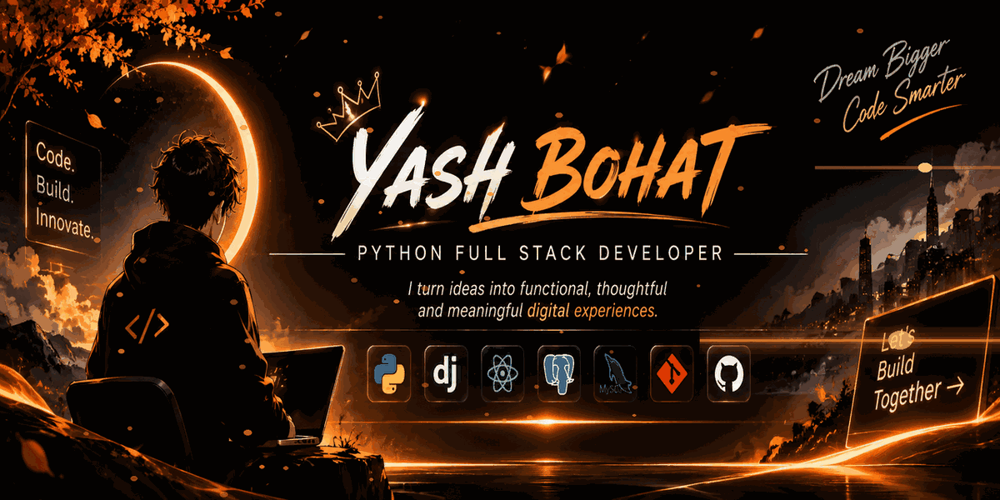

<!-- ========================================================= -->
<!--                    YASH BOHAT                              -->
<!--              GITHUB PROFILE README                         -->
<!-- ========================================================= -->

 

 

# YASH BOHAT

### Python Full Stack Developer · Creative Web Developer

*I turn ideas into functional, thoughtful and meaningful digital experiences.*

 

  

---

## 🍂 About Me

Hello! I'm **Yash Bohat**, a Computer Science graduate and Python Full Stack Developer interested in building practical software, modern web applications and creative digital experiences.

I enjoy working across the development lifecycle — from designing user interfaces and developing REST APIs to managing databases and implementing backend functionality.

Rather than limiting myself to tutorials, I believe in learning by building projects that solve actual problems.

- 🌱 **Currently exploring:** Advanced React, Django and Full Stack Development.
- ⚙️ **Primary focus:** Python, Django REST Framework and React.
- 🗄️ **Database experience:** PostgreSQL and MySQL.
- 🧩 **Development interests:** Backend Engineering, REST APIs and Web Applications.
- 🎓 **Education:** B.Sc. Computer Science Graduate | M.Sc. Computer Science Student.
- 🚀 **Current goal:** Building scalable applications and becoming a stronger software developer.

> *Good software isn't just about writing code. It's about solving the right problems.*

---

## 🧡 Technology Stack

### Frontend Development

### Backend Development

### Databases & Data Management

### Tools & Development Workflow

### Additional Technologies

---

## ✦ Featured Projects

### 01. MentorIND — Educational Platform

A full-stack educational platform designed to bring students, courses and learning opportunities together.

**Key Development Areas:**
- Full-stack application architecture.
- REST API development using Django REST Framework.
- React-based frontend development.
- PostgreSQL database integration.
- Authentication and account management.
- OTP-based verification using MSG91.
- Course access and admission workflows.
- Referral and wallet management functionality.

**Technology Stack:**

`Python` `Django` `DRF` `React` `Vite` `PostgreSQL` `MSG91` `Git`

---

### 02. NovaSyndicate Studios — Creative Web Experience

A creative digital web project focused on modern frontend development, visual storytelling and interactive web experiences.

**Development Focus:**
- Responsive web design.
- Custom UI/UX implementation.
- Modern frontend styling.
- Interactive JavaScript elements.
- Creative visual presentation.

**Technology Stack:**

`HTML` `CSS` `JavaScript`

---

### 03. Sai Supermart — E-commerce Website

An e-commerce project focused on developing an online shopping experience with frontend and backend integration.

**Development Focus:**
- Website structure and responsive layouts.
- Product-oriented user interface.
- Backend integration.
- Database-driven functionality.

**Technology Stack:**

`HTML` `CSS` `JavaScript` `Python` `Django`

---

## 📊 GitHub Analytics

  

---

## 🐍 My Contribution Journey

---

## 🌿 Beyond The Code

I believe becoming a good developer requires more than learning frameworks.

I'm continuously working on:

- Improving problem-solving and logical thinking.
- Understanding software architecture and clean code.
- Building practical full-stack applications.
- Exploring modern web technologies.
- Improving communication and technical knowledge.

I value curiosity, consistency and the willingness to understand how things actually work.

---

## 🤎 Let's Connect

  

### Thanks for visiting my profile!

*Stay curious. Keep creating. Never stop building.* 🍂

 

